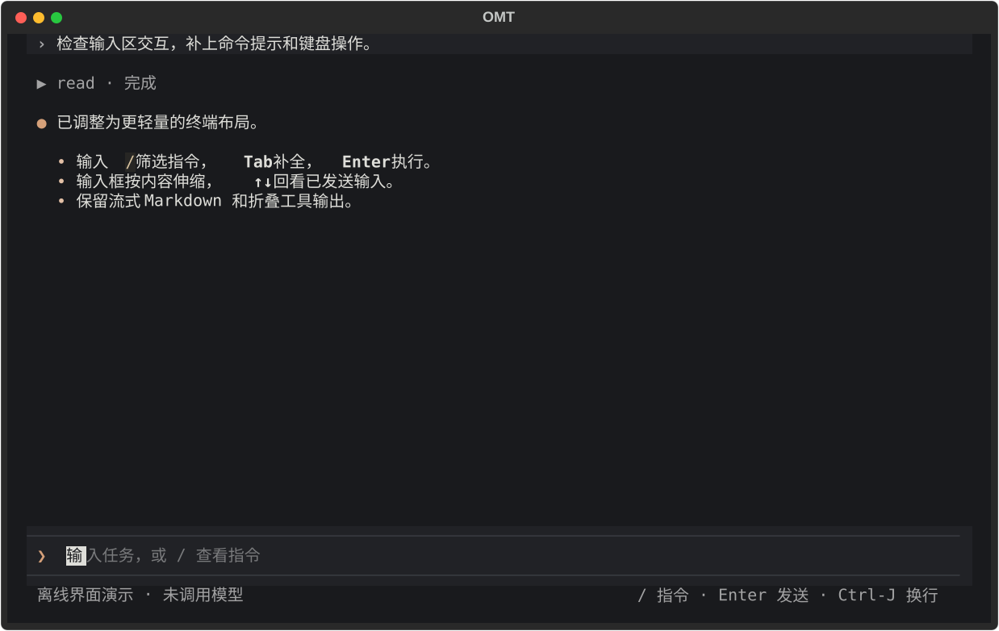
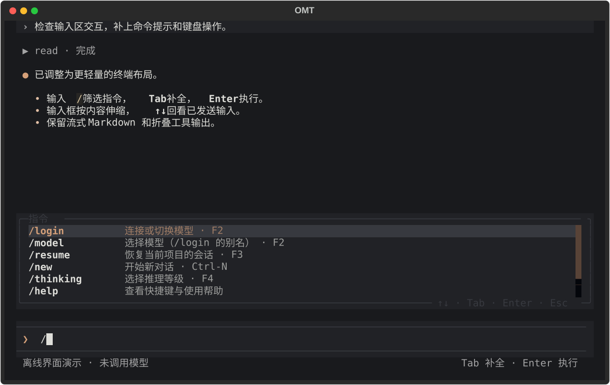

# 交互式 CLI 与 TUI

CLI 与 [HTTP](api.md) 是平级入口，共用 SessionManager 和依赖组装。CLI 不启动 HTTP 服务，也不要求 HTTP 访问令牌。

## 启动

1. `uv sync` 安装依赖，运行 `uv run omt`，默认进入 Textual 全屏界面；`uv run omt --plain` 保留逐行界面。启动通过 core 检查配置；默认厂商/模型、API 凭据或目录项不完整时，提示 F2 / `/login`，不会自动弹出向导或索取参数。
2. 在 CLI 输入 `/login` 添加模型。无模型时完成登录并补齐默认配置后，显式调用 core 的数据库初始化函数创建缺失库，再加载运行环境；已有数据库不修复、不迁移。完整配置的正常启动仍要求预建库，表结构见[索引说明](tests/store.md#接口和预建表约定)。
3. 在可信目标目录启动。文件工具和 Bash 基于进程 cwd，工作目录配置不能代替沙箱。

```bash
# 人工运行，不是离线测试；提交问题可能计费并执行工具。
uv run omt
# 等价模块入口：
uv run python -m omt.cli
```

命令脚本和模块入口均调用 `omt.cli.app.main()`；无参数或 `--tui` 启动 TUI，互斥的 `--plain` 使用原逐行模式。不再提供 `omt configure` 子命令。已有事件循环中，逐行模式用 `await omt.cli.app.run_cli()`，TUI 用 `await omt.cli.terminal.tui.OmtApp().run_async()`，不能嵌套 asyncio.run。共用核心包已由 `omt.coding_agent` 更名为 `omt.core`，不提供旧包兼容导入；此前的 session/runtime 模块与 `CreateAgentSession` 也已移除。低层会话对象为 `omt.core.conversation.Conversation`，默认不显示过程。

## 默认 TUI

采用 coding-agent 风格的内容优先布局：暖色点缀、紧凑的 `›` 用户输入 / `●` 助手输出、折叠工具记录、底部输入框及单行模型状态。不再放置顶部工具栏、大按钮或厚重消息边框；仍使用 Textual 全屏界面，不声称复刻其他客户端的终端滚动机制。输入 `/` 即可发现命令，`/help` 查看全部操作。

下面是用真实组件生成的**离线示例**，文字和工具输出是演示数据，未请求模型：





| 操作 | 快捷键 / 方式 |
| --- | --- |
| 发送 | Enter；不占用额外发送按钮 |
| 输入换行 | Ctrl-J |
| 登录 / 换模型 | F2、`/login` 或 `/model`；分步显示厂商、首次隐藏 Key、模型列表；已登录不再展示密码输入 |
| 恢复会话 | F3 或 `/resume`；上下键/鼠标选择、Enter 确定，绑定稳定会话 ID，不使用逐行编号 |
| 推理等级 | F4 或 `/thinking`；也可输入 `/thinking ` 查看当前模型支持的参数提示，仅影响当前进程 |
| 新对话 | Ctrl-N 或 `/new`；清空当前显示和选择，下一次发消息才创建索引 |
| 指令补全 | `/` 打开并随前缀筛选，↑↓ 选择，Tab 仅补全文字，Enter 执行选中命令；也可鼠标点击 |
| 输入历史 | 在首行 ↑ / 末行 ↓ 回看已发送输入并恢复未发送草稿；多行内部和 Shift-↑↓ 保留编辑行为 |
| 停止当前操作 | Esc；优先收起指令提示而不取消业务；弹窗中取消/返回，Select 展开时先收起选项 |
| 退出 | Ctrl-Q / Ctrl-C，或输入 `/exit` / `/quit`；弹窗中也可退出 |

TUI 支持 `/login`、`/model`（仅 TUI 的 `/login` 别名）、`/resume`（打开会话选择）、`/thinking [level]`、`/new`、`/help`、`/exit`、`/quit`。**与逐行模式的区别**：不支持 `/resume N` 编号或裸词 `resume`，未知斜杠命令提示用法而非提交给模型；没有 Ctrl-D/EOF 的逐行退出约定。普通消息仍保留合法空白与换行，沿用 core 的 1～32000 字符、非全空白、无 NUL 校验。

输入框默认一行，根据换行及软换行伸缩到最多六行；更长内容在编辑器内滚动。输入历史最多 50 条，仅驻留本进程内存，不持久化、不记录指令或登录 Key，不跨启动恢复。多行粘贴、未知命令或已有非法参数不自动改写补全；推理参数只取当前 Runtime 的真实能力，不猜测固定等级。忙时提交新指令不会清空草稿或打断正在执行的请求。

助手以 Markdown 增量展示，工具默认折叠，点击展开；工具屏幕缓冲仅保留末尾 16000 字符，不改 SQLite 历史。回看上方内容时新输出不会强制跳到末尾。缩小窗口时登录表单可滚动，仍能用 Esc 返回。建议使用至少 80×24 的现代终端。

界面在后台执行配置连接、会话查询/恢复和模型请求；同一时间只处理一个业务操作，避免边生成边切模型。Esc 停止后可操作其他会话/新对话，但失败会话的重跑限制仍由 Manager 保持。Ctrl-Q/Ctrl-C 等待当前操作、Manager 和 Saver 清理后退出；这不保证同步工具或外部进程立即停止，不回滚文件和检查点副作用。启动失败显示安全提示，仍可重新登录；不会打印可能含凭据的底层异常。

未配置时启动、打开/取消登录、查看帮助均不创建配置、数据库或空会话。登录成功后才补建缺失库；首条普通消息前才登记会话。数据库、JSON 格式与逐行模式完全共用，不迁移旧历史，也不自动恢复上次对话。凭据只进入隐藏表单，不进入聊天输入或消息历史；`auth.json` 仍是明文加文件权限保护，不是加密存储。

选型依据见 [GitHub 方案调研](research/tui-frameworks.md)，离线交互证据见 [TUI 测试](tests/tui.md)。

## 启动配置

CliSettings 使用 `OMT_CLI_` 前缀，与 `OMT_API_` 独立：

| 变量 | 默认值 / 约束 |
| --- | --- |
| `DB_PATH` | `~/.omt/agent/state/omt.sqlite`，文件与 sessions 表须存在 |
| `WORKSPACE_PATH` | 启动 cwd；规范化后必须等于实际 cwd，不执行 chdir |
| `MAX_CONCURRENT_RUNS` | `1`；共用 Manager 的 run 容量，不是工具并发数；CLI 本身顺序输入 |
| `SKILL_ROOTS` | 默认 `["~/.agents/skills"]`（启动时展开为绝对路径）；JSON 数组可替换，`[]` 关闭发现 |
| `MCP_SERVERS` | 默认 `{}`，不启动外部服务；JSON 对象可显式配置 |

CLI 与 HTTP 均默认不启用 MCP。此前内置的开发者本机 knowledge 路径已移除；需要该服务的部署请显式配置。MCP 字段与类型见 [HTTP 启动配置](api.md#启动配置)，但 CLI 使用自己的环境变量前缀。

```bash
# 例如显式关闭 MCP（与默认值相同）；不影响 HTTP 配置。
export OMT_CLI_MCP_SERVERS='{}'
export OMT_CLI_DB_PATH="$HOME/.omt/agent/state/omt.sqlite"
uv run omt
```

MCP 命令、环境和 headers 属于可信管理员配置，不应包含仓库中的真实凭据。默认启动会读取用户模型认证，不能把启动 CLI 当作无副作用验证命令。

## 逐行模式（--plain）

以下描述保留的 `omt --plain` / `run_cli()` 协议；配置保存、模型重建和会话完整性约束与 TUI 共用。

### /login 模型配置

无模型时仍能输入 `/login`、退出和 EOF；普通请求、/resume、/thinking 只提示先登录，不运行模型或登记会话。已加载模型时同样可 `/login` 添加模型。

1. 展示 core 从注册表取得的厂商和“已登录/未登录”状态，当前只有 `deepseek`。按编号或完整名称选择厂商。
2. 未登录时才输入隐藏的 `api_key`，已有认证直接复用。同厂商只需登录一次；选另一个模型无需再次输入 Key。当前仅支持 API Key；Key 不进入输入历史，取消时也清空密码缓冲并恢复显示状态。
3. 自动经过 core → 注册表 → `ai/models/<厂商>.py` 拉取完整列表，不再询问地址或是否查询。DeepSeek 地址由模块内的 `DEEPSEEK_BASE_URL` 定义，默认 `https://api.deepseek.com`；查询追加 `/models`，十秒超时、最多 1 MiB、不跟随重定向。已有认证时刷新失败可使用本地目录并显示提示；首次拉取失败则不保存，需检查网络或 Key 后重试。
4. 按编号或提供商精确 ID 选择模型。选定后自动保存，不再二次确认；不接受列表之外的手填 ID。普通消息校验器在登录期间暂停，退出后恢复。模型选择完成前 EOF 不落盘，Ctrl-C/外部取消向上传播。

CLI 不直接读写 JSON。core 创建缺失目录并合并三份配置：auth 按厂商共用一个 Key，已登录时不改凭据；model-store 导入该厂商返回的全部 ID，而非只保存选择的一个。同 ID 使用厂商模块定义的地址并保留思考映射/额外元数据，其他厂商及未返回的旧条目保留；已知模型缺失/null 的思考映射由厂商模块补齐，自定义映射（含空表）不覆盖；settings 更新默认厂商和模型，保留已有思考等级。已有非 API 认证和损坏配置不自动覆盖；“已登录”只表示本地保存了非空 Key，不保证它仍有效，没有自动令牌刷新。

首次完成配置后，CLI 立即初始化运行环境，可继续发消息。运行中选择模型会调用 `SessionRuntime.set_model` 重新读取所选定义和认证，再重建 Model/Agent/Manager；保留当前会话、历史、列表编号、MCP 和检查点，不重放消息，也不解除失败保护。沿用当前请求思考等级，新模型缺映射时实际按 none。构建失败仍使用旧运行模型，但默认选择已经保存，CLI 会明确提示这一区别。

每份变更 JSON 用权限为 0600 的临时文件原子替换（POSIX），但三份配置和数据库之间没有跨文件事务或跨进程锁。I/O 失败可能已保存部分文件，修复后重新 `/login`，不要并行登录。

DeepSeek 模块为已确认的 deepseek-flash/deepseek-v4-pro 提供 low/high/max 映射；旧配置只需重新启动并再次 /login 选择该模型即可补齐，不需要删除认证或重输 Key。/models 只返回 ID，不是完整能力目录；未知 ID 不猜测思考能力，不保证所有远程 ID 支持工具调用，也不发送聊天请求探测能力。DeepSeek 协议参考 [模型列表接口](https://api-docs.deepseek.com/api/list-models/)。

### 命令与会话

- `/login`：选择厂商和模型；首次输入 Key，之后复用认证；自动获取完整目录、保存默认选择并切换运行模型。不接受行内参数，避免把 Key 放入命令历史。
- `/exit`、`/quit`、EOF/Ctrl-D：退出，不提交模型。
- `/resume` 或 `resume`：只列出当前工作目录的会话。0 是当前选择，其他编号按最近修改时间排序；未登记时显示“新对话”。
- `/resume N` 或 `resume N`：使用最近展示的编号恢复，成功后显示历史，并清空旧编号。再次切换须重新列出；0 无需恢复。
- `/thinking`：查看当前模型、请求推理等级、实际 `reasoning_effort` 和可选等级。
- `/thinking <level>`：修改当前进程后续请求的推理强度，例如 `/thinking high` 或 `/thinking none`。等级名按模型目录精确匹配，不固定支持 high/max；命令本身不提交模型、不登记会话。
- 命令名忽略大小写；合法普通输入保留首尾空白和换行。输入须为 1～32000 字符、非全空白且无 NUL。`resume` 为保留命令词，但 `resume-help`、未知命令仍作为普通消息。

首条普通消息执行前才登记索引，以原文前 10 字符为标题；直接退出或只列出历史不会留下空会话。登记失败时本轮尚未执行，可再输入重试。恢复与成功回合都会刷新修改时间，只查看列表或历史不刷新。更新时间失败只展示警告，不把成功回合误报为失败，不应因此重跑工具。

恢复通过 Manager 复查目录归属与完整终态，成功后才切换 CLI 当前 ID。无检查点的已登记会话视为空会话；已有但未完成的检查点不能直接继续。

### 推理强度切换

默认启动会展示推理状态；可选等级来自所选模型的 `thinkingLevelMap`，排除 null 值，始终包含 `none`。未配置等级、目录缺少对应能力或值为 null 都按 none 处理，并显示实际结果，不再假定默认 media。例如目录 high→max 时：

```text
You> /thinking high
推理强度已生效，后续请求使用当前配置（仅当前进程，不写回 settings.json）。
模型：deepseek / your-model-id
推理等级：high
实际 reasoning_effort：max
可选等级：none、high、max
```

切换先初始化新的 Model 和 Agent，再由空闲 Manager 创建继任 Manager，成功后关闭旧实例。使用同一 SQLite Checkpointer/Store，保留当前会话 ID、历史、列表编号、工作目录、提示词/Skills、工具与失败保护，不重放历史、不创建新会话。MCP 工具只在启动发现一次，切换时复用。

构建失败保留旧模型和旧显示值，提示失败但不打印 SDK/认证错误原文。活跃运行/历史操作时不取消请求来强制切换；CLI 正常顺序输入，不会在一轮执行中处理新命令。相同请求等级不会重复初始化。

此修改只影响当前 CLI 的所有后续轮次（包括之后恢复的其他会话），不写回 `settings.json`、不修改成功配置缓存、不影响独立 HTTP 进程。`/thinking` 使用当前运行模型的目录快照，不自动读取外部编辑；`/login` 选择模型时才显式重读所选定义。`none` 的请求行为由厂商适配决定：当前已知的 DeepSeek Flash/V4 Pro 会显式下发 none/disabled 关闭推理；旧/未知 ID 仍省略参数，不保证关闭服务端默认思考。

嵌入方的 `run_cli(manager_factory=...)` 仍可提供固定 SessionManager；自定义工厂绕过启动配置检查，此时不额外读取模型配置（显式 `/login` 除外），`/thinking` 仅提示未提供可切换的配置，`/login` 只保存并提示当前入口无法切换。提供 SessionRuntime 的工厂则支持完整功能。

### 失败、取消与边界

- 运行失败/取消可能已经产生工具或检查点副作用。同一 Manager 会阻止该会话直接再次运行或恢复；可选择其他会话，或退出后人工检查。没有自动修复、重置、幂等重试或持久化失败台账。
- Ctrl-C 在输入或执行阶段均结束整个 CLI，而非取消一轮后继续输入；清理流和 Manager 后关闭 SQLite 连接。嵌入式调用的外部任务取消仍向上传播。
- CLI 只展示过程事件一次，不再次打印最终 answer。历史不展示系统消息、artifact 或模型元数据，但正文和工具参数没有通用脱敏。
- CLI/API 共用实现不代表独立进程共享内存互斥。不要同时用两个入口或多个进程写同一会话；没有跨进程锁。
- 工具有当前系统用户权限，不提供文件沙箱、审批或副作用回滚。同步工具线程或外部进程可能不能立即取消。

离线验证见 [CLI 测试](tests/cli.md)、[推理强度测试](tests/thinking.md)、[/resume 测试](tests/resume.md)和 [Conversation 测试](tests/conversation.md)。
